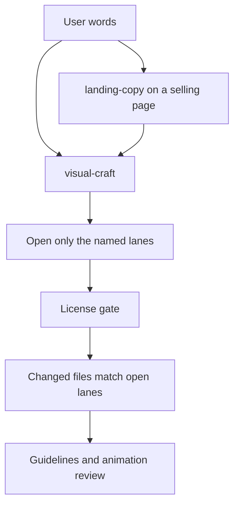

# Visual craft design

Date: 2026-10-16

Status: design for review. This document does not add a skill, a catalog file, or assets. Implementation starts after this design is accepted.

Related audits: [source-audit.md](source-audit.md), [skill-shortlist.md](skill-shortlist.md).

## Goal

A person asks Cursor, in ordinary words, for a landing page, a style, an animation, or an icon. The agent opens only the lanes that request names. It can restyle a page, add one animation to an existing screen, or swap icons, without rebuilding the rest of the UI.

shadcn/ui is the install pipe for registry components and the default component set when a new screen needs buttons, forms, and dialogs. It is not a required visual style. A request that says "only the animation" leaves the current components and theme in place.

The agent does not browse a gallery and recreate a component from memory. The agent does not keep a private mirror of LottieFiles, Icons8, or Hover.dev.

## Decision

Use a thin project skill as a router, plus a short catalog of install records.

| Approach | Result |
| --- | --- |
| Router skill and a short catalog | Chosen. The skill knows when to look, which source is legal, and which command installs real code. |
| Only the skills in the shortlist | Rejected as the whole system. They improve taste and shadcn usage. They do not encode the license gate or the source list. They remain dependencies. |
| A custom MCP that scrapes the sites | Rejected for v1. Registries already return source. Scrapers break when markup changes and collide with licenses that forbid compiling a competing collection. |

Prior art, read and not copied: https://github.com/AnayDhawan/Components maps a named effect to a live shadcn registry URL. The same shape is used here. Their catalog text and component list are not imported.

## Units

### Marketing skill

Installed skill: `landing-copy` (see [skill-shortlist.md](skill-shortlist.md)).

One job: decide who the page is for, what single action it asks for, and what claim has to be believable. That output is the brief. It does not install components and it does not pick a registry effect.

skills.sh has several marketing skills. They write positioning and page copy. None of them selects an animation or a visual system. `landing-copy` is the one marketing skill in the install bundle because it names the page job (category introduction, campaign, pricing, product selection, and so on) without also dictating layout code.

### Router skill

Source path: `skills/visual-craft/SKILL.md` in this repository. A product install lands in `.agents/skills/visual-craft/`, which Cursor reads as a project skill.

One job: read the user's words and, on a selling page, the `landing-copy` brief. Open or close each lane. Choose catalog ids only for open lanes. Hand installs to the shadcn CLI when the chosen record uses a registry.

It loads on requests for landing pages, visual polish, animation, icons, empty states, and themes. The description names those triggers and names the lane words ("only animation", "keep the current style", "icons only"). The body stays short and points at the catalog and this design.

### Catalog

Path: `skills/visual-craft/catalog.yaml`, so the catalog travels with the skill into `.agents/skills/visual-craft/`.

One job: map a role to an install command and a license tag. The agent reads the matching records, then runs the command. The catalog does not contain component source.

v1 roles, a handful of records each, not the full upstream libraries:

- auth
- button
- hero
- background
- text
- card
- empty
- success
- icon
- theme
- lottie (procedure record, no animation binary)

`auth` stands for a whole screen block, not a single control. Pricing, settings, and similar named blocks use the same lookup rule even before they have their own catalog records.

### License gate

One job: stop an install that fails the rules in the next section. The gate is a checklist inside the skill, applied before every `add`.

### Style brief

Used only when the style lane is open. One `DESIGN.md` in the product root, copied from https://github.com/voltagent/awesome-design-md or written for the product. tweakcn supplies CSS variables when the theme is also allowed to change. An existing `DESIGN.md` stays the brief until the user asks for a different mood.

### Review skills

One job: after the UI exists, `web-design-guidelines` and `review-animations` check the diff. They do not select sources.

## Lanes

The router starts with every lane closed. A lane opens from the user's words or from the page job `landing-copy` produced. Closed lanes are not touched.

| Lane | Opens when | What it may change | Stays closed when |
| --- | --- | --- | --- |
| Style | "make it look like…", a new marketing page, or no visual brief exists yet | One `DESIGN.md`, and a tweakcn theme if tokens should change | "keep the current style", "only the animation", "only icons" |
| Structure | The user asks for a screen, a named block, a form, a dialog, or a control | A registry block or component for that piece, then fitted to the open style | "only the animation", "only the style", or the project already has that block |
| Motion | An action needs feedback, or the user asked for a design or a visual | One catalog effect on the first screen, or short feedback on the control that changed | "no animation", or a request that never mentions motion, a design, or a page |
| Icons | The user asks for icons, or a new control has an empty icon slot | Lucide icons | The screen already uses a chosen icon set and the user did not ask to replace it |
| Illustration | The user asks for an animated illustration or a success/empty scene that a component cannot carry | One Lottie file under the license gate | Everything else |

`landing-copy` names the audience and the claim. The page job does not set a visual ceiling. A pet shop, a technical store, a landing page, and a one-page tool use the same visual rule.

| User asked for | Style | Motion |
| --- | --- | --- |
| A design, a restyle, a site, or a visual | Open, unless they said to keep the current style. One `DESIGN.md`. | One first-screen effect, plus press, error, and success on actions |
| Only a control, or only the animation | Closed | Feedback on that control |
| Nothing visual, and a theme already exists | Closed | Feedback on the action they named |

Explicit user words beat the table. "Only the animation" opens Motion and leaves Style and Structure closed. Product type does not cancel the first-screen effect. A named extra, including a background, another animation, or a QR code, is built. One quiet page is a recommendation, not a cap. A product feature the catalog does not list is built in the project.

## Blocks

A named product block is not a separate skill. Auth, pricing, a settings panel, an empty state: the router already has the job. One skill per block would multiply conflicting instructions. The catalog plus a registry search is what stops Cursor from inventing the screen.

When the user names a block, the agent does this in order:

1. Look up that role in the catalog.
2. If the catalog has no record yet, run `npx shadcn@latest search` across the configured registries for that block. Read the docs of the chosen item before writing any markup.
3. Install the free source with the CLI. For authentication the default is a shadcn login block, for example `npx shadcn@latest add login-01`. The CLI picks the variant that matches the project's base library.
4. Fit the installed block to the open style lane. Spacing, radius, type, and color come from the current theme and, when the style lane is open, from `DESIGN.md`. The agent does not redraw the form.
5. Add the motion that this block earns. On auth that is press feedback on the submit control, a visible error state, and a success state. Focus moving between fields stays immediate. A marketing auth page may also have one entrance on the card. Keystrokes are not animated.

An effect from Magic UI, React Bits, or Aceternity may sit beside that block, as the one viewport moment or as the success illustration. It does not replace the form. A decorative card with no labels, errors, or keyboard path is not an auth block.

The same sequence applies to any later block: find a real implementation, install it, fit it to the style, then add the motion that belongs to its actions.

Registry effects from Magic UI, React Bits, and Aceternity still install through the shadcn CLI. That requires `components.json` in the product. Initializing that file configures the pipe. It does not replace existing buttons, layouts, or colors. The structure lane is what adopts shadcn components.

## Flow



Effect libraries target React and Tailwind. Flutter, the Icons8 Flutter set, and mobile UI kits are out of this version. A product that is not React plus Tailwind can take the marketing brief and the motion rule as guidance, and the skill stops before a registry install.

## License gate

Run this before installing or downloading anything.

1. The record's verdict in the source audit is Catalog, or the request meets a Conditional rule exactly.
2. Commercial use inside an end product is free. Paid namespaces are refused: `@magicui-pro`, React Bits Pro, Aceternity blocks and templates, Hover items that are not marked Free, Refero MCP.
3. The catalog stores a command and a URL. It does not store upstream component source, and this repository does not store Lottie or Icons8 files.
4. React Bits and Aceternity may be used inside the product. Their source is not republished as a component library, template, or marketplace listing.
5. A Lottie file is downloaded only after the specific animation page states the Lottie Simple License. One file per request. Premium animations stop the task.
6. A Hover component is copied only when the user points at a page marked Free.
7. Icons are Lucide. Icons8 is unused in v1.
8. A `DESIGN.md` from awesome-design-md guides tokens and tone. Logos, wordmarks, and brand assets are not copied.

If a check fails, the agent says which rule failed and picks another catalog record. It does not invent a lookalike of the blocked component.

## Motion rule

Motion answers a state change or carries the single memorable moment on a marketing page.

| Situation | Motion |
| --- | --- |
| Press, hover on a fine pointer, open or close of an occasional overlay, success, error, empty-state invitation | Short feedback. `transform` and `opacity`, `ease-out`, under 300ms. Press uses a small scale, about `0.97`. |
| Keyboard shortcut, command palette, or any control used many times a day | No animation. |
| First screen, when the user asked for a design or a visual | One effect from the catalog (hero, background, or text). A looping background is allowed. The rest of the page stays quiet. Product type does not remove this row. |
| `prefers-reduced-motion` | Keep color and opacity changes. Drop movement. |

This is the build rule. It matches `frontend-design` (action motion is welcome, scattered entrance motion is a tell) and the frequency bar in `review-animations` (high-frequency actions stay still). A success moment may use a catalog effect or a single Lottie file. A static paragraph does not get a looping animation.

## Catalog record

The block below shows the field shape. `spotlight` is a placeholder slug until implementation confirms a live registry item.

```yaml
id: hero-spotlight
role: hero
source: aceternity
tier: free
license: aceternity-end-product
install: npx shadcn@latest add @aceternity/spotlight
registry: https://ui.aceternity.com/registry/spotlight.json
when: one memorable first-screen effect on a marketing page
limits:
  - one full-viewport effect per page
  - refuse if the upstream page is marked Pro or Block
```

Fields:

- `id` — stable name the skill mentions.
- `role` — one of the v1 roles.
- `source` — shadcn, magicui, react-bits, aceternity, luxe, tweakcn, lucide, lottiefiles.
- `tier` — `free`. Anything else is absent from the file.
- `license` — short tag that points back to the source audit.
- `install` — the exact command. Luxe records use `npx luxe add`. Theme records use a tweakcn registry URL.
- `registry` — the URL the command resolves, when there is one.
- `when` — the situation that earns this record.
- `limits` — extra refusals.

React Bits ids keep the `TS-TW` suffix. The skill substitutes the project's package runner when `packageManager` is pnpm or bun.

A lottie record has no `install` URL of a specific animation. Its `when` text is the procedure: search the free gallery, open one page, confirm Lottie Simple License, save that file under the product's `public/animations/`, render it with `lottie-react` or `@lottiefiles/dotlottie-react`.

Illustrative records for the first catalog, to be verified against the live registry at implementation time:

| Role | First candidate | Command shape |
| --- | --- | --- |
| button | shadcn `button`, then a Luxe variant if the brief asks for a stronger control | `npx shadcn@latest add button` |
| hero | one free Aceternity or Magic UI hero effect | `npx shadcn@latest add @aceternity/{name}` |
| background | one React Bits or Magic UI background | `npx shadcn@latest add @react-bits/{Name}-TS-TW` |
| text | one React Bits text effect | same registry form |
| card | shadcn `card` | `npx shadcn@latest add card` |
| empty | shadcn `empty` | `npx shadcn@latest add empty` |
| success | shadcn state plus optional one Lottie | procedure record |
| icon | Lucide through the shadcn icon library | no separate download |
| theme | one tweakcn built-in, starting with a confirmed id such as `zinc` | `npx shadcn@latest add https://tweakcn.com/r/themes/{id}.json` |

Names that fail `shadcn search` or return a pro payload are dropped during implementation. The design does not freeze a component that has not been installed once.

## Registries in the product

`components.json` in the product:

```json
{
  "registries": {
    "@aceternity": "https://ui.aceternity.com/registry/{name}.json",
    "@react-bits": "https://reactbits.dev/r/{name}.json",
    "@magicui": "https://magicui.design/r/{name}.json"
  }
}
```

Confirm each URL with one `shadcn add` during implementation. If a namespace 404s, retry with and without the `.json` suffix and keep the URL that installs. shadcn's own registry needs no entry. Some namespaces are built into the CLI; an explicit entry keeps the product stable if that directory changes.

Optional Cursor MCP, in the product's `.cursor/mcp.json`:

```json
{
  "mcpServers": {
    "shadcn": {
      "command": "npx",
      "args": ["shadcn@latest", "mcp"]
    }
  }
}
```

## How a product connects

This repository is the home of the skill and the catalog. A product does not import this repo as a library. Nothing in the shortlist is installed yet; the commands below are the bundle a future connect guide will run.

1. Install the bundle from [skill-shortlist.md](skill-shortlist.md): `landing-copy`, `frontend-design`, `shadcn`, `web-design-guidelines`, `review-animations`.
2. Install `visual-craft` into the product at `.agents/skills/visual-craft/` (the `skills` CLI with `--agent cursor` writes project skills there).
3. Add `components.json` only when a registry install is needed. Add the registry block above. Initializing shadcn does not restyle the app.
4. Copy a `DESIGN.md` only when the style lane is opened for that product.
5. Optionally enable the shadcn MCP.

Personal skills under `~/.cursor/skills/` are an alternative when every local project should see the router. Project skills are the default, because the catalog and the license gate travel with the repository that uses them.

## What v1 leaves out

- A custom MCP and any site scraper.
- Vendored component source and a local animation archive.
- Refero MCP, Icons8, Hover automation, and every paid tier named in the source audit.
- Flutter and React Native.
- More than one `DESIGN.md` in a product.
- The impeccable command suite and extra taste skills.

## Acceptance check for the later implementation

The implementation is done when the same product passes both of these sessions.

Selling page, with no extra constraints: the agent runs the marketing brief, opens style, structure, and one viewport effect, installs those pieces, and leaves keyboard-heavy controls still.

Follow-up in that same product: "only the animation on the success state." The agent opens the motion lane, adds one effect or one licensed Lottie file, and does not change `DESIGN.md`, theme tokens, or existing components.

Both sessions refuse a pro registry name and a bulk Lottie download.

A third session, "add an auth screen", installs a real login block from the registry, fits it to the current style, and adds submit, error, and success motion. The form layout on disk is the installed block, not a hand-written stack of inputs.
