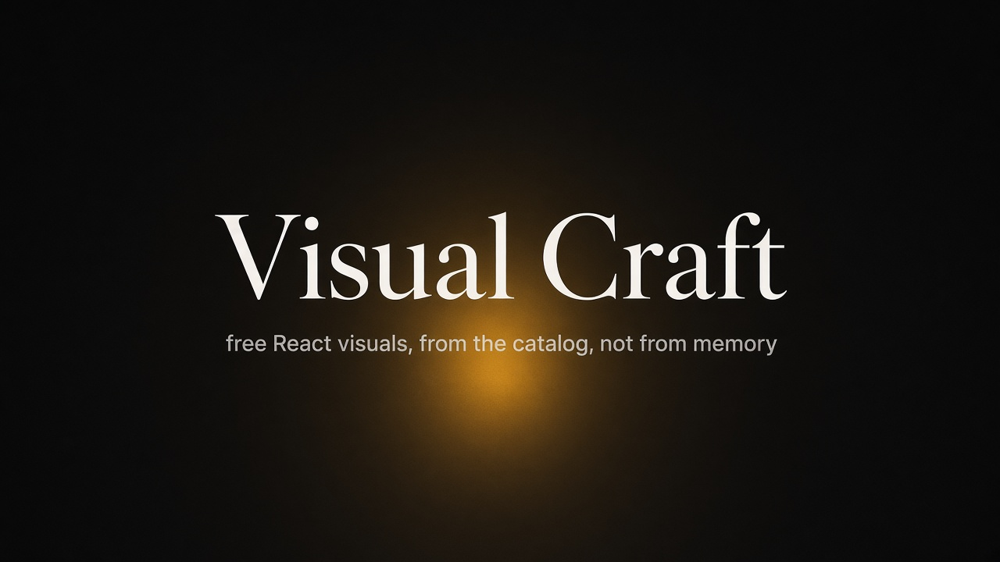

# Visual Craft

[English](README.md)



Внешний MCP-сервер и пак правил для Cursor. В проекте на React и Tailwind Cursor ставит настоящие бесплатные компоненты из каталога. Сервер сам файлы в этот проект не пишет.

## Как это работает

Запущенный сервер отвечает, что ставить. Пак отвечает, куда это положить. Просьба человека важнее вкуса: названные фон, вторая анимация или QR-код делаются. Отказ остаётся на лицензии, чужом логотипе и платном реестре.

`examples/burger-life` — пробный лендинг в этом репозитории. Это не инструкция по установке.

## Первое сообщение

В новом проекте:

> Используй Visual Craft для этого дизайна. Также используй пак `<путь-к-клону>/pack/visual-craft`.

## Дальше

> Используй Visual Craft.

Путь к паку повторяют, только если на этот проект ещё ни разу не запускали `install-visual-craft.bat`.

## Запуск

Запуск: `start-visual-craft-mcp.bat`. Остановка: `stop-visual-craft-mcp.bat`. На другой системе та же точка слушается командой `node mcp/visual-craft/src/http.js`.

Добавьте это внутрь `mcpServers` в `%USERPROFILE%\.cursor\mcp.json` (на macOS и Linux это `~/.cursor/mcp.json`):

```json
"visual-craft": {
  "url": "http://127.0.0.1:3847/mcp"
}
```

В Cursor перечитайте список MCP. Проект уже должен быть на React и Tailwind.

## Источники

Берётся только бесплатная версия каждого сайта.

- [shadcn/ui](https://ui.shadcn.com)
- [Magic UI](https://magicui.design), бесплатные компоненты
- [Aceternity UI](https://ui.aceternity.com), бесплатные компоненты
- [React Bits](https://reactbits.dev), бесплатные записи TypeScript и Tailwind
- [Luxe](https://www.luxeui.com)
- [tweakcn](https://tweakcn.com), токены тем
- [Lucide](https://lucide.dev)
- [LottieFiles](https://lottiefiles.com), один файл, на странице которого указана Lottie Simple License
- [Hover.dev](https://www.hover.dev), только страница с пометкой Free
- [awesome-design-md](https://github.com/voltagent/awesome-design-md), только настроение, без логотипов

Pro-реестры, Refero MCP и Icons8 в эту сборку не входят.

Скиллы со skills.sh, которые едут вместе с паком: `landing-copy`, `frontend-design`, `shadcn`, `web-design-guidelines`, `review-animations`.
